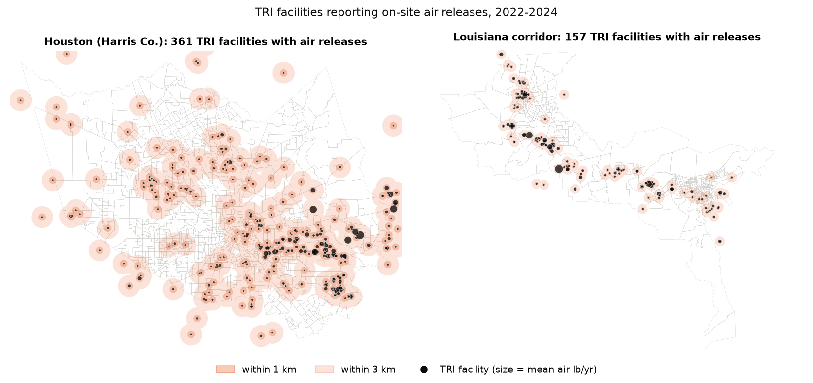
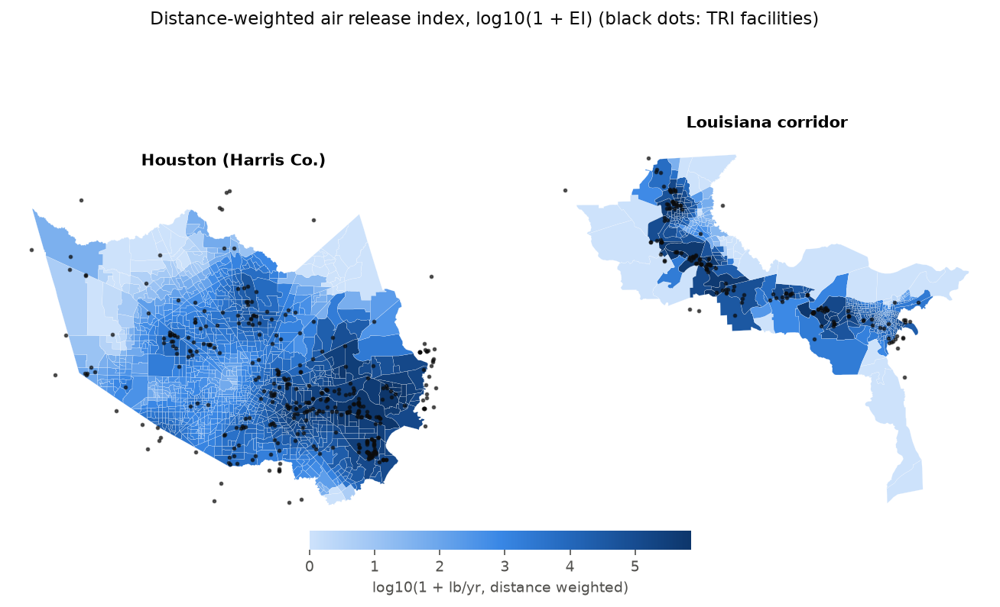
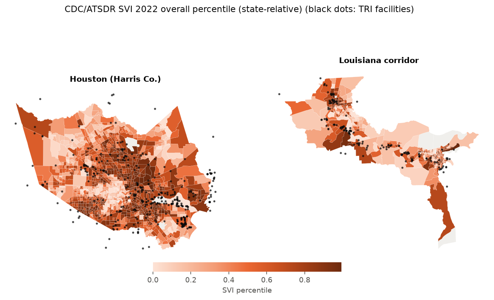
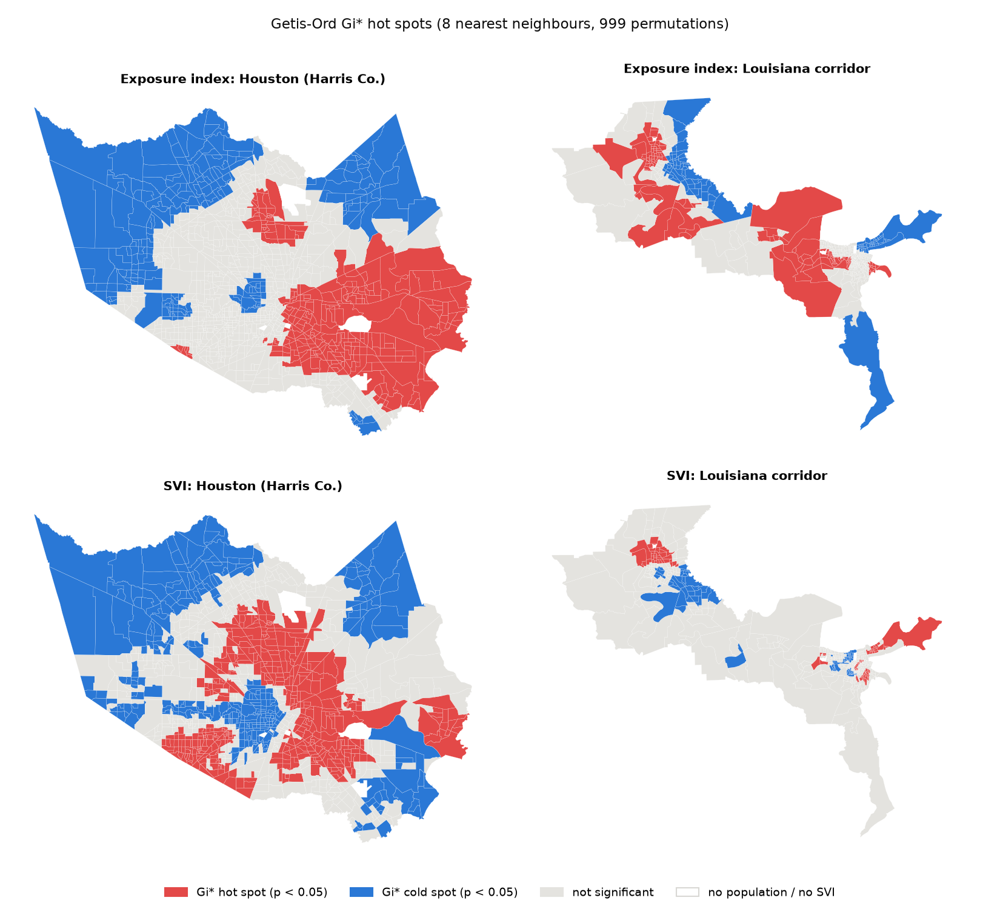
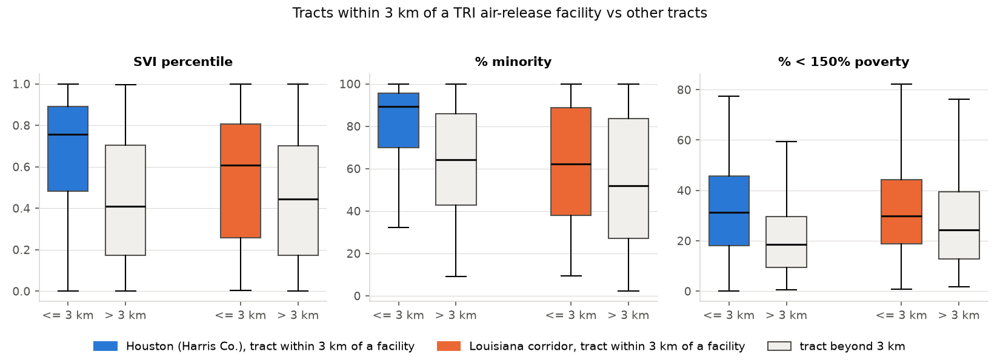
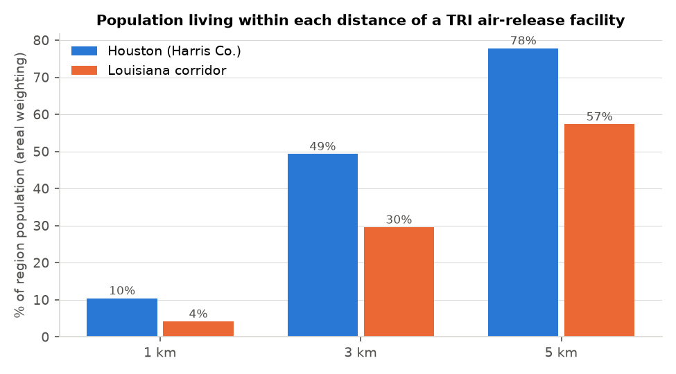
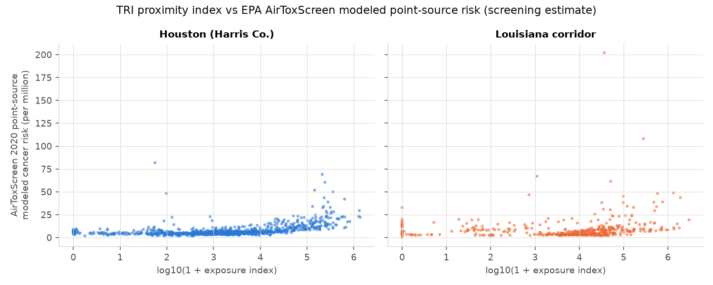

# Industrial Air-Release Proximity: Houston Ship Channel vs the Louisiana Mississippi River Corridor

This project compares how close residents live to industrial facilities that report air releases to the EPA Toxics Release Inventory (TRI), and who lives there, in two Gulf Coast industrial regions: Harris County, Texas (which contains the Houston Ship Channel), and the nine-parish Mississippi River industrial corridor in Louisiana, from East Baton Rouge Parish to Orleans Parish. It uses TRI reports for 2022-2024, 2022 census tracts, and the CDC/ATSDR Social Vulnerability Index (SVI) 2022. For each tract it estimates the population inside 1, 3 and 5 km facility buffers and a distance-weighted air-release index. It then compares tracts near facilities with tracts farther away, maps Getis-Ord Gi* hot spots, and checks the index against EPA AirToxScreen 2020 modeled risk and AQS PM2.5 monitors. **This is an exposure-proximity analysis only. It does not measure doses and makes no claims about health outcomes.**

This is an independent analysis of public data. It is separate from the datasets used in my LSU dissertation.

## Why it matters

Environmental health, environmental justice and air-permitting roles in Texas (TCEQ, Houston Health Department, Harris County Pollution Control) and Louisiana (LDEQ, LDH) often need this kind of screening: where facilities are, how many people live nearby, and whether nearby communities score higher on social vulnerability. The workflow uses standard tools for those roles: public EPA and Census data, buffers and areal weighting, a simple exposure index, nonparametric group comparisons with effect sizes, and local hot spot statistics. It also exports GIS layers that open directly in ArcGIS Pro, QGIS and Google Earth Pro.

## Data sources

All data are public and were downloaded without an account or API key. Access date for every file: 2026-10-23 (see `data/download_log.csv` for exact URLs and file sizes).

| Dataset | Provider | Years / version | Link | Records used |
|---|---|---|---|---|
| TRI Basic Data Files, Texas and Louisiana | U.S. EPA | 2022, 2023, 2024 (2024 is the latest year posted) | https://www.epa.gov/toxics-release-inventory-tri-program/tri-basic-data-files-calendar-years-1987-present (files from `data.epa.gov/efservice/downloads/tri/mv_tri_basic_download/{YEAR}_{ST}/csv`) | 37,545 facility-chemical-year rows read; 640 facilities in or within 10 km of the study regions; 518 with on-site air releases above zero |
| TIGER/Line census tracts | U.S. Census Bureau | 2022 (2020 tract geography) | https://www2.census.gov/geo/tiger/TIGER2022/TRACT/ (`tl_2022_48_tract.zip`, `tl_2022_22_tract.zip`) | 1,610 study tracts (1,115 Harris; 495 Louisiana corridor) |
| Social Vulnerability Index, state files | CDC/ATSDR | SVI 2022 (ACS 2018-2022) | https://svi.cdc.gov/Documents/Data/2022/csv/states/Texas.csv and `.../Louisiana.csv` | 1,597 tracts with population above zero and an SVI score (1,110 Harris; 487 Louisiana) |
| AirToxScreen block-level cancer risk by source group | U.S. EPA | 2020 assessment (released 2024) | https://gaftp.epa.gov/rtrmodeling_public/AirToxScreen/2020/Cancer/BySource/ (`Region6a_...xlsx`, `Region6b_...xlsx`) | 59,529 populated blocks aggregated to 1,603 tracts |
| AQS annual concentration by monitor | U.S. EPA | 2022-2024 | https://aqs.epa.gov/aqsweb/airdata/download_files.html (`annual_conc_by_monitor_{YEAR}.zip`) | PM2.5 FRM/FEM (parameter 88101, "PM25 Annual 2012" standard): 16 sites, 48 site-years |

Study regions (county and parish FIPS): Harris County 48201. Louisiana corridor: East Baton Rouge 22033, West Baton Rouge 22121, Iberville 22047, Ascension 22005, St. James 22093, St. John the Baptist 22095, St. Charles 22089, Jefferson 22051, Orleans 22071.

## Methods

All steps run in Python (GeoPandas, Shapely, SciPy, PySAL `libpysal` and `esda`). Distances use WGS 84 / UTM zone 15N (EPSG:32615).

1. **Facilities and releases.** For every TRI facility, on-site air releases are fugitive (form section 5.1) plus stack (5.2) releases, summed over all chemicals. Dioxin-type chemicals reported in grams are converted to pounds. Each facility's annual mean for 2022-2024 counts a year with no report as zero. Two subsets are also kept: chemicals flagged as carcinogens by TRI, and all chemicals except ammonia, because ammonia makes up most of the reported mass in Louisiana. Facilities in the study counties, or within 10 km of them, are kept so that tracts near a boundary still see facilities across the line.
2. **Buffer analysis.** Facilities with any air release are buffered at 1, 3 and 5 km, and the buffers are dissolved for each region. Tract population (SVI `E_TOTPOP`) is split by the share of tract area inside the buffer (areal weighting, which assumes people are spread evenly within a tract). Population-weighted means of SVI and selected ACS estimates are computed inside and outside each buffer.
3. **Exposure index.** For each tract's representative interior point, EI = sum over facilities of (mean air release, lb/yr) x exp(-d / 2 km), for facilities within 10 km. The index is reported as log10(1 + EI). It is a relative proximity-and-magnitude score, not a concentration or dose. Three versions are computed: all chemicals, carcinogens only, and all chemicals except ammonia.
4. **Exposed vs unexposed tracts.** A tract is "near" a facility if its interior point lies within 1, 3 or 5 km of one (3 km is the main definition). Near and far tracts are compared with the Wilcoxon rank-sum (Mann-Whitney) test. The effect size is the rank-biserial correlation r (equal to Cliff's delta; positive means higher values in near tracts). p-values are adjusted with Benjamini-Hochberg across each table. Spearman correlations link the index to each variable.
5. **Hot spots.** Getis-Ord Gi* (star = True) on log10(1 + EI) and on SVI, per region. It uses binary 8-nearest-neighbour weights on tract points, 999 conditional permutations and a fixed seed. Tracts with pseudo p < 0.05 are classed as hot or cold spots, and FDR-adjusted counts are also reported.
6. **Comparisons with other data.** AirToxScreen 2020 block-level modeled cancer risk is aggregated to tracts as a population-weighted mean. Because EPA rounds the published "Total" column (for example to 30), the total is rebuilt as the sum of the 39 unrounded source-group columns. The point-source group is also kept. The exposure index is also computed at each AQS PM2.5 monitor and compared with that monitor's 2022-2024 mean annual concentration.

## Key findings

All numbers come from the run in this repository (`outputs/tables/`).

- **Facilities.** Harris County plus a 10 km margin has 361 TRI facilities with air releases (309 inside the county). The Louisiana corridor has 157 (139 inside the parishes). In-region mean on-site air releases were about 9.9 million lb/yr in Harris County and 29.7 million lb/yr in the Louisiana corridor. Ammonia accounts for about 15.9 million lb/yr of the corridor's releases (counting the 10 km margin), and one nitrogen fertilizer plant (Donaldsonville) reports about 8.0 million lb/yr on its own. In Harris County the largest chemicals by mass are ethylene, propylene and ammonia.
- **People near facilities.** In Harris County, about 0.49 million people (10.4%) live within 1 km of a TRI air-release facility, 2.33 million (49.3%) within 3 km and 3.68 million (77.8%) within 5 km. In the Louisiana corridor the figures are 66,000 (4.2%), 464,000 (29.6%) and 900,000 (57.4%).
- **Who lives near facilities.** Inside the 3 km buffers, the population-weighted SVI percentile is 0.67 vs 0.44 outside in Harris County, and 0.56 vs 0.43 in the Louisiana corridor. The share of residents who belong to a racial or ethnic minority group is 81% vs 64% (Harris) and 63% vs 52% (Louisiana).
- **Tract comparisons (3 km definition).** In Harris County, the 569 near tracts have a median SVI of 0.76, against 0.41 for the 541 far tracts (rank-biserial r = 0.40, q < 0.001). Medians for % minority, % below 150% of poverty, % without a high school diploma, % uninsured and % limited English are also higher, with r between 0.37 and 0.43. In the Louisiana corridor the differences point the same way but are smaller: SVI 0.61 vs 0.44 (r = 0.20, q < 0.001), % minority r = 0.15, poverty r = 0.15. Uninsured and limited-English rates do not differ there. At 1 km, only 19 Louisiana tracts qualify as near, and no difference reaches significance.
- **Index vs vulnerability.** The Spearman correlation between log10(1 + EI) and SVI is 0.47 in Harris County and 0.16 in the Louisiana corridor.
- **Hot spots.** In Harris County, 263 tracts are Gi* hot spots for the exposure index. Most are in east and southeast Harris County along the Ship Channel, with a smaller cluster in the north. For SVI, 398 tracts are hot spots, and 170 tracts are hot spots for both measures. In the Louisiana corridor the counts are 126 for the index, 90 for SVI and 28 for both. Index hot spots are in East Baton Rouge (42 tracts), Jefferson (27), Orleans (22) and St. Charles (13) parishes, with smaller groups in Ascension, St. John the Baptist, Iberville and West Baton Rouge. SVI hot spots are mainly in Orleans (41), East Baton Rouge (30) and Jefferson (16).
- **Region contrast.** The median all-chemical index is higher in the Louisiana corridor (log10 4.07 vs 3.22, r = -0.32). Most of that gap is ammonia: without ammonia the medians are 3.59 vs 3.21 (r = -0.09). With carcinogens only, Harris County is slightly higher (2.54 vs 2.37, r = 0.08). The median distance from a tract to the nearest facility is 2.9 km in Harris County and 4.1 km in Louisiana.
- **AirToxScreen check.** The index agrees moderately with EPA's modeled point-source cancer risk in Harris County (Spearman rho = 0.52) and weakly in Louisiana (rho = 0.24). Harris tracts within 3 km of a facility have slightly higher modeled point-source risk (median 5.8 vs 4.9 per million, r = 0.23). In Louisiana, tracts within 5 km have lower modeled point-source risk than tracts farther away (4.2 vs 6.6 per million, r = -0.15). Total mass of releases is therefore a poor stand-in for toxicity-weighted modeled risk in that corridor. AirToxScreen values are screening-level model estimates, not measured health outcomes.
- **PM2.5 monitors.** Across 2022-2024, the median annual mean PM2.5 is 10.5 ug/m3 at 10 Harris County sites and 8.4 ug/m3 at 6 Louisiana corridor sites. The index is not related to monitor PM2.5 in Harris County (rho = -0.09). In Louisiana rho is 0.83 (p = 0.04), but with only 6 monitors this is not a reliable result. TRI does not cover PM2.5, which comes mostly from traffic, regional and secondary sources.

## Figures


*Figure 1. TRI facilities reporting on-site air releases (2022-2024 mean) with 1 km and 3 km buffers.*


*Figure 2. Distance-weighted air-release index by tract (log10 scale).*


*Figure 3. CDC/ATSDR SVI 2022 overall percentile (ranked within each state).*


*Figure 4. Getis-Ord Gi* hot and cold spots for the exposure index (top) and SVI (bottom).*


*Figure 5. SVI, % minority and % below 150% poverty in tracts within vs beyond 3 km of a facility.*


*Figure 6. Share of each region's population within 1, 3 and 5 km of a facility.*


*Figure 7. Exposure index vs AirToxScreen 2020 modeled point-source cancer risk by tract.*

## Limitations

- Proximity is not exposure. The index ignores stack height, wind, chemistry and dispersion, and it weights all pounds equally. EPA's RSEI or AirToxScreen are better tools for toxicity-weighted exposure.
- TRI is self-reported, covers only facilities above reporting thresholds, and leaves out mobile, area and many smaller sources. Short-term emission events reported to state agencies may not be fully reflected in the annual totals.
- The Houston region is all of Harris County, not only the Ship Channel. The Ship Channel appears as the main hot spot rather than being drawn as its own boundary.
- Areal weighting assumes even population within each tract. TIGER tract polygons include water area, so population inside buffers near the channel and the river may be slightly overstated or understated.
- "Near" is judged from one interior point per tract, so large rural tracts can be misclassified.
- SVI percentiles are ranked within each state. Compare SVI within a region, and use the raw ACS percentages (`EP_*` fields) to compare across regions.
- AirToxScreen 2020 uses 2020 emissions and is a screening model. Its time frame differs from the TRI 2022-2024 window.
- Cross-sectional associations at tract level cannot show cause, and they are subject to the ecological fallacy and the modifiable areal unit problem.
- ArcGIS Pro, ArcPy, Google Earth Engine and Google Earth Pro were not run for this project. All results come from the open-source Python pipeline.

## How to run

Requires Python 3.11 or newer. About 300 MB of downloads, most of it the two optional AirToxScreen files.

```bash
python -m venv .venv
source .venv/bin/activate
pip install -r requirements.txt
bash run_all.sh            # download, prepare, analyse, plot
# or step by step:
python scripts/01_download.py     # raw files go to ./data_raw (set RAW_DIR to change)
python scripts/02_prepare.py      # cleaned files in data/
python scripts/03_analysis.py     # tables in outputs/tables, layers in outputs/gis
python scripts/04_figures.py      # figures in outputs/figures
```

Set `SKIP_AIRTOX=1` before step 1 to skip the large AirToxScreen download. Step 2 then skips that dataset, and steps 3 and 4 drop the AirToxScreen comparisons and Figure 7. The EPA gaftp server can be slow, so step 1 resumes interrupted downloads.

To repeat the buffer, overlay and hot spot steps in ArcGIS Pro, QGIS or Google Earth Pro, see `docs/arcgis_qgis_workflow.md`.

## Repository structure

```
industrial-emissions-proximity-houston-baton-rouge/
  README.md
  LICENSE
  requirements.txt
  run_all.sh
  scripts/
    01_download.py        public data download (keyless, resumable)
    02_prepare.py         TRI, tract, SVI, AQS and AirToxScreen cleaning
    03_analysis.py        buffers, exposure index, Wilcoxon, Spearman, Gi*, GIS export
    04_figures.py         maps and charts
  data/                   small cleaned files (facility releases, tracts + SVI, AQS, AirToxScreen tract means, download log)
  docs/
    arcgis_qgis_workflow.md
  outputs/
    figures/              fig1 to fig7 (PNG)
    tables/               CSV results
    gis/                  industrial_proximity.gpkg (tracts, facilities, buffers, monitors), tri_facilities.kml
```

## Citation and author

Anamika Dristi, Ph.D.

Dristi, A. (2026). *Industrial air-release proximity: Houston Ship Channel vs the Louisiana Mississippi River corridor* [Code and data]. GitHub: anamikadristi/industrial-emissions-proximity-houston-baton-rouge.

Contact: anamikadristi@gmail.com

Data credits: U.S. EPA (TRI, AirToxScreen, AQS), U.S. Census Bureau (TIGER/Line), CDC/ATSDR (SVI 2022). Code is MIT licensed. The data keep their original public terms.
